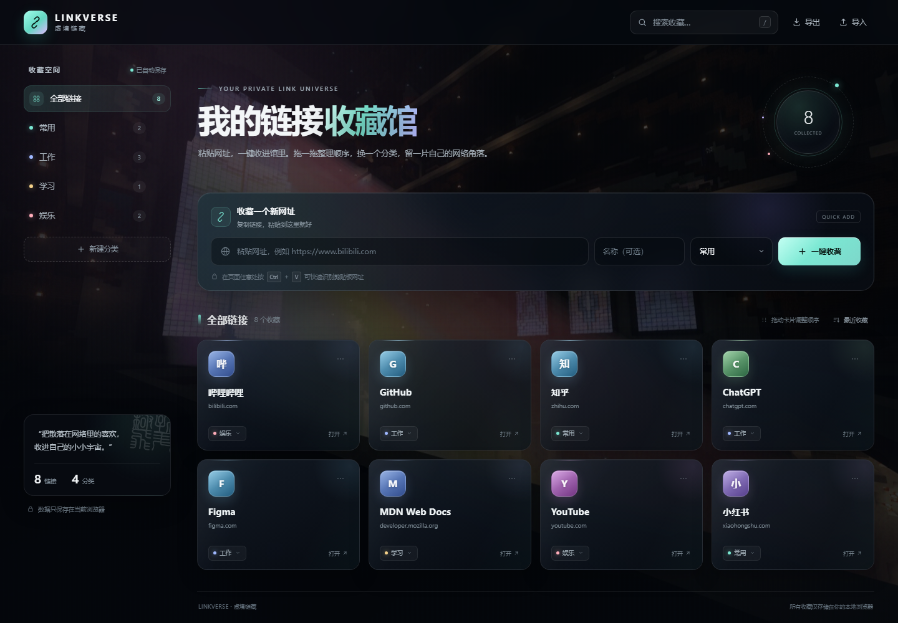

# 虚境链藏 · LINKVERSE

一个可以直接双击打开、完全运行在本地的私人网址收藏馆。粘贴链接就能收藏，支持拖动排序、分类整理、搜索和换分类，所有数据保存在浏览器本地，关闭网页也不会丢失。



## 快速开始

1. 解压整个文件夹（不要只把 `index.html` 单独拿出来，`css/`、`js/`、`assets/` 需要和它放在一起）。
2. 双击 `index.html`，或双击 `打开虚境链藏.bat`。
3. 复制网址后，在页面任意空白处按 `Ctrl + V`，网址会自动填入收藏框。
4. 点击「一键收藏」。

建议使用 Chrome 或 Edge。

## 主要功能

| 功能 | 使用方式 |
| --- | --- |
| 粘贴收藏 | 在网址框中粘贴链接后点「一键收藏」；也可在页面任意处按 `Ctrl + V` 快速填入 |
| 自动识别名称 | 不填名称时按常见网站自动命名；也可以自己填写最多 40 个字 |
| 关闭不丢 | 收藏、分类、排序、当前分类都会保存在浏览器本地 |
| 拖动排序 | 用鼠标按住卡片拖到新位置，顺序会自动保存 |
| 更换分类 | 点卡片底部的分类标签，选择目标分类 |
| 新建 / 重命名 / 删除分类 | 左侧分类栏，或分类右侧 `···` 菜单；删除分类时链接会自动移到「常用」 |
| 快速删除 | 卡片右上角 `···` → 删除；短时间内可在提示条上撤销 |
| 打开网站 | 点击卡片任意空白处，或卡片菜单中的「打开」；会在新标签页打开 |
| 搜索 | 顶部搜索框，或按 `/` 聚焦；支持按名称、网址、分类搜索 |
| 编辑 | 卡片 `···` → 编辑名称、网址和分类 |
| 备份 | 顶部「导出」下载 JSON；「导入」可从备份恢复（会覆盖当前收藏） |

## 快捷键

- `Ctrl + V`：在页面任意位置粘贴网址，自动填入收藏框
- `/`：聚焦搜索框
- `Esc`：关闭弹窗 / 菜单，或清空搜索
- 卡片聚焦时按 `Enter` 或空格：打开该网站

## 数据说明

- 数据使用浏览器 `localStorage` 保存，不会上传到任何服务器。
- 清除浏览器网站数据、使用无痕模式，或更换浏览器，都可能导致收藏不可见。
- 重要收藏建议定期用顶部「导出」备份。
- 双击打开（`file://`）和使用本地服务器打开（`http://`）属于不同的存储位置，建议固定使用同一种打开方式。

## 自定义

- 背景图：替换 `assets/bg.jpg`（推荐 16:9，1920×1080 左右）。
- 浏览器标签图标：替换 `assets/favicon.svg`。
- 首次打开时显示的示例网站：编辑 `js/app.js` 中的 `seedState`（仅在浏览器没有旧数据时生效）。
- 想重新开始：在浏览器控制台执行 `localStorage.removeItem("linkverse.library.v1"); location.reload();`。

## 文件结构

```text
index.html              页面结构
打开虚境链藏.bat          Windows 快捷启动
css/style.css            视觉样式与响应式布局
js/app.js                收藏、分类、拖拽、导入导出等逻辑
assets/bg.jpg            背景图
assets/seal.png          侧栏印章装饰
assets/favicon.svg       标签页图标
preview.png              README 预览图
```

## 常见问题

**双击后页面样式不对？**  
请确认 `css/`、`js/`、`assets/` 和 `index.html` 在同一个文件夹内，且文件名没有被修改。

**为什么换了一台电脑收藏不见了？**  
收藏只存在当前浏览器本地。请在原电脑「导出」备份，再到新电脑「导入」。

**拖不动卡片？**  
请用鼠标拖动卡片空白区域，不要从按钮或分类标签上开始拖；触屏设备暂不支持拖动排序。

**网址需要写 `https://` 吗？**  
不需要，`bilibili.com` 会自动补全为 `https://bilibili.com`。
